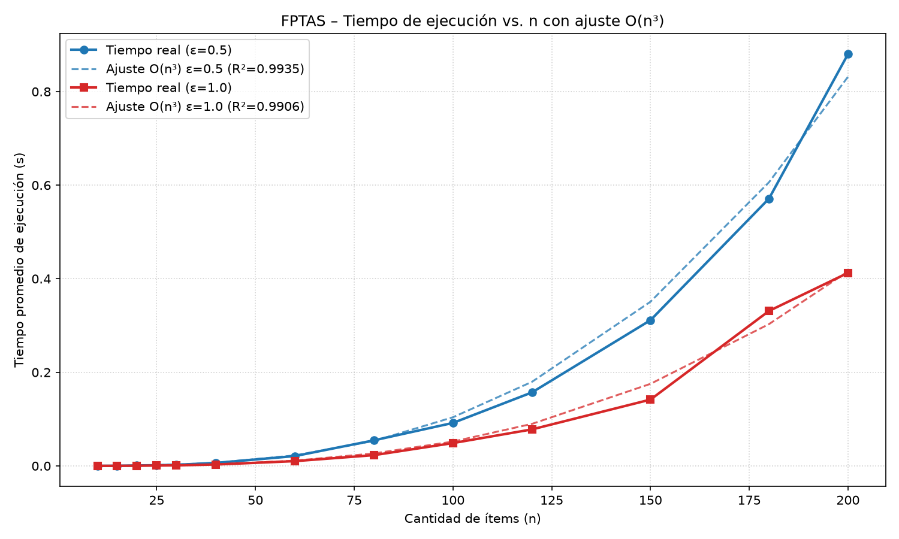
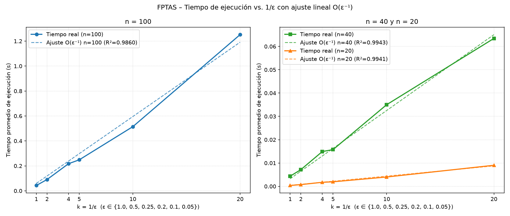

# Problema 2 – Algoritmos Aproximados: Esquema Arbitrariamente Bueno (FPTAS)

**Materia:** Teoría de Algoritmos (TB024) – FIUBA  
**Trabajo Práctico 2**

---

## 1. Supuestos, Condiciones y Limitaciones

El algoritmo implementado (`tp02/Problema_02/fptas.py`) resuelve el Problema de la Mochila 0-1 bajo las siguientes premisas:

1. **Dominio de entrada:**
   - Se dispone de una mochila con capacidad entera no negativa $W \in \mathbb{Z}_{\ge 0}$ y $n$ ítems, cada uno con peso entero positivo $w_i \in \mathbb{Z}^+$ y beneficio entero positivo $v_i \in \mathbb{Z}^+$.
   - Cada ítem puede incluirse completo o descartarse ($x_i \in \{0, 1\}$).
2. **Prefiltrado previo de factibilidad:**
   - Antes de calcular el beneficio máximo $v^* = \max_i v_i$, se descartan todos los ítems con $w_i > W$ (o $v_i \le 0$).
   - Este supuesto es indispensable para la demostración teórica de la garantía: garantiza que todo ítem considerado cabe individualmente en la mochila, asegurando que $v^* \le OPT$.
3. **Condición sobre el parámetro de aproximación $\varepsilon$:**
   - Siguiendo el criterio visto en clase, el parámetro debe cumplir $\varepsilon \in (0, 1]$ y **$k = 1/\varepsilon \in \mathbb{Z}^+$** (por ejemplo, $\varepsilon \in \{1.0, 0.5, 0.25, 0.2, 0.1, 0.05\}$).
4. **Limitación práctica (umbral $b \le 1$):**
   - El factor de escala es $b = \frac{\varepsilon}{2n} \cdot v^*$. Cuando $v^*$ permanece fijo y pequeño respecto de $n$ (como ocurre en el set estándar del TP1 donde $v_i \in [1, 1000]$), a partir de $n \ge \frac{\varepsilon \cdot v^*}{2}$ resulta $b \le 1$.
   - En esa región, el reescalado $\hat{v}_i = \lceil v_i / b \rceil$ deja de comprimir el dominio de beneficios y expande la cantidad de columnas de la tabla respecto de la PD exacta, aunque permite verificar el escalamiento cúbico $O(n^3 \varepsilon^{-1})$ en el rango analizado.

---

## 2. Diseño del Algoritmo

### 2.1. Pseudocódigo

```text
Algoritmo Mochila_FPTAS(elementos, W, epsilon):
    Validar W >= 0, epsilon en (0, 1] y k = 1 / epsilon entero positivo

    // 1. Prefiltrado de ítems factibles
    Si W == 0 o elementos está vacío:
        Devolver (beneficio=0, peso=0)
    candidatos <- [(w, v) para cada (w, v) en elementos si 0 < w <= W y v > 0]
    Si candidatos está vacío:
        Devolver (beneficio=0, peso=0)

    // 2. Factor de escala y redondeo al múltiplo de b superior más cercano
    n <- longitud(candidatos)
    v_max <- max(v para (_, v) en candidatos)
    b <- (epsilon / (2 * n)) * v_max

    Para cada (w, v) en candidatos:
        v_hat <- techo((2 * n * k * v) / v_max)   // equivalente exacto a techo(v / b)

    V_max <- suma(v_hat)

    // 3. Programación Dinámica alternativa OPT(i, V): peso mínimo para lograr beneficio escalado V
    dp[0] <- 0
    dp[1 .. V_max] <- W + 1                       // representa +infinito
    beneficio_real[0 .. V_max] <- 0
    v_acum <- 0

    Para cada (w, v, v_hat) en escalados:
        v_acum <- v_acum + v_hat
        Para V = v_acum bajando hasta v_hat:
            Si dp[V - v_hat] + w < dp[V]:
                dp[V] <- dp[V - v_hat] + w
                beneficio_real[V] <- beneficio_real[V - v_hat] + v

    // 4. Búsqueda del máximo beneficio escalado factible
    Para V = V_max bajando hasta 0:
        Si dp[V] <= W:
            Devolver (beneficio_real[V], dp[V])

    Devolver (0, 0)
```

### 2.2. Garantía de calidad $(1 + \varepsilon)$

Sea $S^*$ el subconjunto óptimo del problema original y $S$ la solución óptima obtenida con los beneficios redondeados hacia arriba $\tilde{v}_i = \hat{v}_i \cdot b$. Dado que $v_i \le \tilde{v}_i < v_i + b$:

$$\sum_{i \in S^*} v_i \le \sum_{i \in S^*} \tilde{v}_i \le \sum_{i \in S} \tilde{v}_i \le \sum_{i \in S} (v_i + b) \le n b + \sum_{i \in S} v_i$$

Como $n b = \frac{\varepsilon}{2} v^*$ y para $\varepsilon \in (0, 1]$ se cumple $\sum_{i \in S} v_i \ge \frac{1}{2} v^*$, resulta $n b \le \varepsilon \sum_{i \in S} v_i$, obteniendo la cota garantizada:

$$OPT = \sum_{i \in S^*} v_i \le (1 + \varepsilon) \sum_{i \in S} v_i$$

Es fundamental devolver `beneficio_real[V]` ($\sum_{i \in S} v_i$) y no $V^* \cdot b$, ya que los $\tilde{v}_i$ están redondeados hacia arriba y sobrestimarían la ganancia real.

### 2.3. Estructuras de datos utilizadas

- **Lista de tuplas `escalados`:** pares `(peso, beneficio_original, v_hat)` con aritmética entera exacta `(2 * n * k * beneficio + v_max - 1) // v_max` para evitar errores de punto flotante en el redondeo techo.
- **Arreglo unidimensional `dp` (longitud $V_{\max} + 1$):** compacta la matriz 2D `OPT(i, V)` en un único vector actualizado de derecha a izquierda (`V` decreciente hasta `v_hat`), evitando reutilizar un mismo ítem y reduciendo el consumo de memoria a $O(V_{\max})$.
- **Arreglo paralelo `beneficio_real` (longitud $V_{\max} + 1$):** almacena directamente la suma de los beneficios originales correspondiente al peso mínimo registrado en `dp[V]`, evitando mantener matrices de reconstrucción adicionales.

---

## 3. Seguimiento Manual con Set de Datos Reducido

Sea la instancia reducida de $n = 4$ ítems, capacidad $W = 10$ y parámetro $\varepsilon = 0.5$ ($k = 1/\varepsilon = 2$):

| Ítem $i$ | Peso $w_i$ | Beneficio $v_i$ | $\hat{v}_i = \lceil v_i / b \rceil$ | $\tilde{v}_i = \hat{v}_i \cdot b$ |
|---:|---:|---:|---:|---:|
| 1 | 4 | 300 | 6 | 300 |
| 2 | 5 | 420 | 9 | 450 |
| 3 | 6 | 510 | 11 | 550 |
| 4 | 8 | 800 | 16 | 800 |

- Todos los ítems verifican $w_i \le 10$.
- $v^* = \max(300, 420, 510, 800) = 800$.
- Factor de escala:
  $$b = \frac{\varepsilon}{2n} \cdot v^* = \frac{0.5}{2 \cdot 4} \cdot 800 = 50$$
- Suma total escalada: $V_{\max} = 6 + 9 + 11 + 16 = 42$.

### Evolución de `OPT(i, V)` (solo estados alcanzables con peso finito)

- **$i = 0$ (sin ítems):** `OPT(0, 0) = 0`; resto $+\infty$.
- **$i = 1$ (ítem 1: $w_1 = 4, \hat{v}_1 = 6$):**
  - `V=0: 0`, `V=6: 4`.
- **$i = 2$ (ítem 2: $w_2 = 5, \hat{v}_2 = 9$):**
  - `V=0: 0`, `V=6: 4`, `V=9: 5`, `V=15: 9`.
- **$i = 3$ (ítem 3: $w_3 = 6, \hat{v}_3 = 11$):**
  - `V=0: 0`, `V=6: 4`, `V=9: 5`, `V=11: 6`, `V=15: 9`, **`V=17: 10`** (beneficio real `300 + 510 = 810`), `V=20: 11`, `V=26: 15`.
- **$i = 4$ (ítem 4: $w_4 = 8, \hat{v}_4 = 16$):**
  - `V=0: 0`, `V=6: 4`, `V=9: 5`, `V=11: 6`, `V=15: 9`, `V=16: 8` (`800`), **`V=17: 10`** (`810`), `V=20: 11`, `V=22: 12`, `V=25: 13`, `V=26: 15`, `V=27: 14`, `V=31: 17`, `V=33: 18`, `V=36: 19`, `V=42: 23`.

### Selección final y verificación de la cota

- El mayor $V$ con `dp[V] <= 10` es **$V^* = 17$** (peso `10`), con `beneficio_real[17] = 810` (ítems `{1, 3}`).
- Óptimo exacto: $OPT = 810$. Se cumple $810 \le (1 + 0.5)\cdot 810 = 1215$.

---

## 4. Análisis de Complejidad

### 4.1. Complejidad Temporal (deducida del pseudocódigo)

1. **Prefiltrado y cálculo de escala:** recorrer los $n$ ítems para filtrar $w_i \le W$, hallar $v^*$ y calcular cada $\hat{v}_i$ insume **$O(n)$**.
2. **Cota de columnas $V_{\max}$:**
   $$\hat{v}_i = \left\lceil \frac{v_i}{b} \right\rceil \le \left\lceil \frac{v^*}{\frac{\varepsilon}{2n} v^*} \right\rceil = \frac{2n}{\varepsilon} = O(n \varepsilon^{-1})$$
   Por lo tanto, el máximo beneficio escalado total es:
   $$V_{\max} = \sum_{i=1}^n \hat{v}_i \le n \cdot \frac{2n}{\varepsilon} = O(n^2 \varepsilon^{-1})$$
3. **Llenado de la tabla de Programación Dinámica:**
   - El bucle externo itera $n$ veces (una por cada candidato).
   - El bucle interno recorre a lo sumo $V_{\max}$ columnas, realizando comparaciones y asignaciones en $O(1)$ por celda.
   - Costo de la PD: $n \cdot O(n^2 \varepsilon^{-1}) = \mathbf{O(n^3 \varepsilon^{-1})}$.
4. **Búsqueda de $V^*$:** recorrer `dp` de $V_{\max}$ hacia $0$ es $O(n^2 \varepsilon^{-1})$.

**Complejidad temporal total:**

$$T(n, \varepsilon) = O(n^3 \varepsilon^{-1})$$

- Para cualquier $\varepsilon > 0$ fijo, el algoritmo es **estrictamente polinomial en $n$** ($O(n^3)$).
- Al variar $\varepsilon$, el tiempo crece **linealmente con $1/\varepsilon$** ($O(\varepsilon^{-1})$), por lo que respecto de la longitud en bits de $\varepsilon$ sigue siendo pseudopolinomial.

### 4.2. Complejidad Espacial

- Los dos arreglos unidimensionales (`dp` y `beneficio_real`) ocupan **$O(V_{\max}) = O(n^2 \varepsilon^{-1})$** en memoria.

---

## 5. Sets de Datos y Criterios de Selección

Todas las instancias comparten el formato estándar del TP1 (línea 1: capacidad $W$; líneas siguientes: `peso,beneficio`):

1. **Instancias estándar (`tp02/Mochilas/`):**
   - Generadas con `tp02/crear_mochila.py` (semilla `42 + n`, $W = 50n$, $w_i \in [1, 200]$, $v_i \in [1, 1000]$).
   - Utilizadas para comparar directamente con el óptimo exacto (`mochila_tradicional`) en $n \in \{10, 15, 20, 25, 30, 40, 100, 200\}$.
2. **Instancias intermedias (`tp02/Problema_02/sets_datos/intermedios/`):**
   - Tamaños $n \in \{60, 80, 120, 150, 180\}$ generados por `datos.py` con la misma semilla y distribución (`42 + n`).
   - *Criterio:* cubrir la brecha entre $n=40$, $100$ y $200$ para evaluar con precisión la curva cúbica $O(n^3)$ en el rango viable.

---

## 6. Tiempos de Ejecución y Gráficos

Las mediciones corresponden al promedio de **3 repeticiones** por instancia ejecutadas con `tp02/Problema_02/problema_02.py`.

### 6.1. Experimento 1 – Variando $n$ con $\varepsilon \in \{1.0, 0.5\}$

| $n$ | $W$ | $\varepsilon$ | FPTAS | Óptimo (DP) | Peso FPTAS | Gap Relativo | Tiempo FPTAS (s) |
|---:|---:|---:|---:|---:|---:|---:|---:|
| 10 | 500 | 1.00 | 4526 | 4526 | 470 | 0.000000 | 0.000064 |
| 10 | 500 | 0.50 | 4526 | 4526 | 470 | 0.000000 | 0.000077 |
| 15 | 750 | 1.00 | 4495 | 4495 | 723 | 0.000000 | 0.000112 |
| 15 | 750 | 0.50 | 4495 | 4495 | 723 | 0.000000 | 0.000204 |
| 20 | 1000 | 1.00 | 9940 | 9940 | 993 | 0.000000 | 0.000350 |
| 20 | 1000 | 0.50 | 9940 | 9940 | 993 | 0.000000 | 0.000842 |
| 25 | 1250 | 1.00 | 12497 | 12497 | 1248 | 0.000000 | 0.000695 |
| 25 | 1250 | 0.50 | 12497 | 12497 | 1248 | 0.000000 | 0.001406 |
| 30 | 1500 | 1.00 | 10901 | 10901 | 1489 | 0.000000 | 0.001087 |
| 30 | 1500 | 0.50 | 10901 | 10901 | 1489 | 0.000000 | 0.002311 |
| 40 | 2000 | 1.00 | 17020 | 17020 | 1996 | 0.000000 | 0.002964 |
| 40 | 2000 | 0.50 | 17020 | 17020 | 1996 | 0.000000 | 0.006339 |
| 60 | 3000 | 1.00 | 25198 | 25198 | 3000 | 0.000000 | 0.010147 |
| 60 | 3000 | 0.50 | 25198 | 25198 | 3000 | 0.000000 | 0.021001 |
| 80 | 4000 | 1.00 | 31854 | 31854 | 3988 | 0.000000 | 0.022967 |
| 80 | 4000 | 0.50 | 31854 | 31854 | 3988 | 0.000000 | 0.054605 |
| 100 | 5000 | 1.00 | 41688 | 41688 | 4998 | 0.000000 | 0.048734 |
| 100 | 5000 | 0.50 | 41688 | 41688 | 4998 | 0.000000 | 0.091803 |
| 120 | 6000 | 1.00 | 51189 | 51189 | 5998 | 0.000000 | 0.077979 |
| 120 | 6000 | 0.50 | 51189 | 51189 | 5998 | 0.000000 | 0.157022 |
| 150 | 7500 | 1.00 | 56588 | 56589 | 7497 | 0.000018 | 0.141687 |
| 150 | 7500 | 0.50 | 56588 | 56589 | 7497 | 0.000018 | 0.311378 |
| 180 | 9000 | 1.00 | 76461 | 76461 | 8990 | 0.000000 | 0.331143 |
| 180 | 9000 | 0.50 | 76461 | 76461 | 8990 | 0.000000 | 0.571270 |
| 200 | 10000 | 1.00 | 84580 | 84580 | 9999 | 0.000000 | 0.412545 |
| 200 | 10000 | 0.50 | 84580 | 84580 | 9999 | 0.000000 | 0.880093 |



### 6.2. Experimento 2 – Variando $\varepsilon$ con $n \in \{20, 40, 100\}$

| $n$ | $W$ | $\varepsilon$ | $k = 1/\varepsilon$ | FPTAS | Óptimo (DP) | Gap Relativo | Tiempo FPTAS (s) |
|---:|---:|---:|---:|---:|---:|---:|---:|
| 20 | 1000 | 1.00 | 1 | 9940 | 9940 | 0.000000 | 0.000362 |
| 20 | 1000 | 0.50 | 2 | 9940 | 9940 | 0.000000 | 0.000742 |
| 20 | 1000 | 0.25 | 4 | 9940 | 9940 | 0.000000 | 0.001731 |
| 20 | 1000 | 0.20 | 5 | 9940 | 9940 | 0.000000 | 0.001938 |
| 20 | 1000 | 0.10 | 10 | 9940 | 9940 | 0.000000 | 0.004000 |
| 20 | 1000 | 0.05 | 20 | 9940 | 9940 | 0.000000 | 0.009032 |
| 40 | 2000 | 1.00 | 1 | 17020 | 17020 | 0.000000 | 0.004344 |
| 40 | 2000 | 0.50 | 2 | 17020 | 17020 | 0.000000 | 0.007161 |
| 40 | 2000 | 0.25 | 4 | 17020 | 17020 | 0.000000 | 0.014917 |
| 40 | 2000 | 0.20 | 5 | 17020 | 17020 | 0.000000 | 0.015744 |
| 40 | 2000 | 0.10 | 10 | 17020 | 17020 | 0.000000 | 0.035013 |
| 40 | 2000 | 0.05 | 20 | 17020 | 17020 | 0.000000 | 0.063434 |
| 100 | 5000 | 1.00 | 1 | 41688 | 41688 | 0.000000 | 0.042813 |
| 100 | 5000 | 0.50 | 2 | 41688 | 41688 | 0.000000 | 0.090613 |
| 100 | 5000 | 0.25 | 4 | 41688 | 41688 | 0.000000 | 0.217342 |
| 100 | 5000 | 0.20 | 5 | 41688 | 41688 | 0.000000 | 0.248440 |
| 100 | 5000 | 0.10 | 10 | 41688 | 41688 | 0.000000 | 0.514531 |
| 100 | 5000 | 0.05 | 20 | 41688 | 41688 | 0.000000 | 1.252074 |



---

## 7. Informe de Resultados

1. **Correspondencia con la complejidad teórica $O(n^3 \varepsilon^{-1})$:**
   - Al variar $n \in [10..200]$ con $\varepsilon$ fijo, el ajuste por mínimos cuadrados $t(n) = c \cdot n^3$ obtuvo **$R^2 = 0.993532$** para $\varepsilon = 0.5$ ($c = 1.039501 \times 10^{-7}$) y **$R^2 = 0.990636$** para $\varepsilon = 1.0$ ($c = 5.195515 \times 10^{-8}$). La relación entre las pendientes ($1.0395 / 0.5196 \approx 2.00$) acompaña exactamente el factor $k = 1/\varepsilon = 2$.
   - Al fijar $n$ y variar $k = 1/\varepsilon \in \{1, 2, 4, 5, 10, 20\}$, el ajuste lineal $t(k) = c \cdot k$ alcanzó **$R^2 = 0.994134$** ($n = 20$, $c = 4.379121 \times 10^{-4}$), **$R^2 = 0.994257$** ($n = 40$, $c = 3.252498 \times 10^{-3}$) y **$R^2 = 0.986016$** ($n = 100$, $c = 5.956483 \times 10^{-2}$).
   - Esto confirma empíricamente que el algoritmo escala de manera cúbica en $n$ y lineal en $\varepsilon^{-1}$, en total correspondencia con la complejidad $O(n^3 \varepsilon^{-1})$ deducida del pseudocódigo.
2. **Calidad de aproximación frente a la cota garantizada:**
   - En el 100% de las 44 ejecuciones se cumplió $OPT \le (1 + \varepsilon) \cdot Z_{\text{FPTAS}}$.
   - En 42 de las 44 corridas el algoritmo obtuvo el óptimo exacto (`gap = 0`), y en las dos restantes ($n = 150$ con $\varepsilon = 1.0$ y $\varepsilon = 0.5$) la diferencia fue de apenas 1 unidad sobre $56\,589$ (desvío relativo `0.000018`, es decir $0.0018\%$), muy por debajo de la cota teórica permitida.
3. **Compromiso tiempo vs. precisión:**
   - Reducir $\varepsilon$ (aumentar $1/\varepsilon$) permite acotar arbitrariamente el error respecto del óptimo, pero incrementa proporcionalmente el tiempo y la memoria requerida. Por ello, para la comparativa general resulta conveniente fijar un valor intermedio como $\varepsilon = 0.5$.

---

## 8. Referencias Bibliográficas (APA 7ma edición)

- Cormen, T. H., Leiserson, C. E., Rivest, R. L., & Stein, C. (2022). *Introduction to algorithms* (4th ed.). MIT Press.
- Kleinberg, J., & Tardos, É. (2005). *Algorithm design*. Addison-Wesley.
- Martello, S., & Toth, P. (1990). *Knapsack problems: Algorithms and computer implementations*. John Wiley & Sons.
